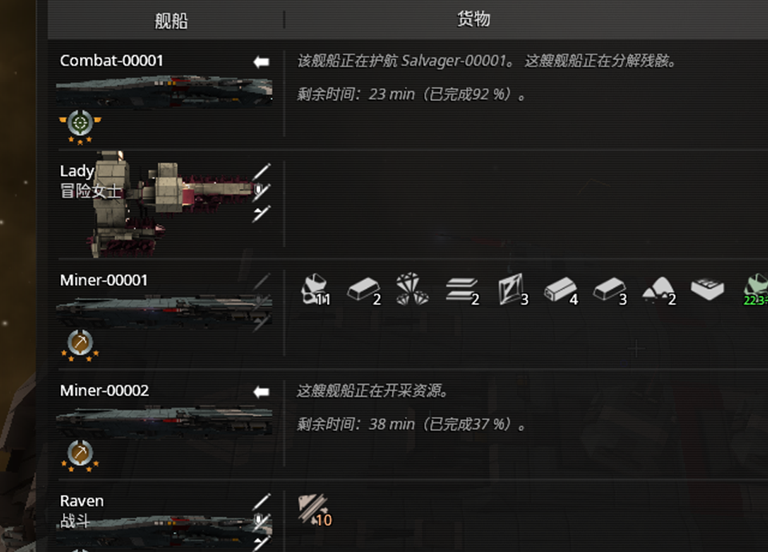
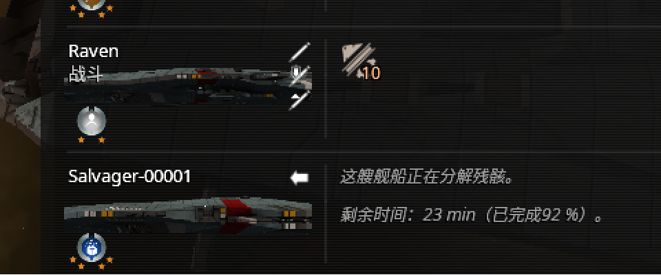

# 船的类型 / 称号 —— 到底是哪个字段（2026-10-17 真机取证）

> 上一级：[`docs/game/README.md`](../README.md)。
> ★ 主人点破的：本鱼上一轮说「原版没有船类型/角色字段」✗ —— **错了** ✓。
>   类别不在 `Entity` 的属性表里，而在 **`ShipDatabaseEntry` 的 title** 上 ✓。

## 0. 一句话结论

**每艘船的「类别/称号」= `ShipDatabaseEntry:getTitle()`（返回 `Format`）。**

* 服务端也有这一份 ✓ → **跨星区、后台模拟中的船照样读得到** ✓（不需要那艘船有实体 ✓）。
* 翻译后就是**舰队界面船名下面那行小字** ✓：本档 `Raven` 的 title 是 `Combat`，
  界面显示「战斗」——`localization/zh.po:51080-51081` `msgid "Combat"` → `msgstr "战斗"` ✓✓。
* ★ 玩家自建船**常常是空串** ✓：`""` = **原版确实没给这船写类别**，
  与「读不到」是两件事 ✗✓（本 mod 用 `shipTitleKnown` 分开它们 ✓）。

## 1. 为什么是这个字段（file:line）

| 证据 | 出处 |
|---|---|
| 服务端可读：`function Format getTitle()` | `Documentation/ShipDatabaseEntry [Server].html:848-853` |
| 服务端可写：`function var setTitle(NamedFormat title)` | `Documentation/ShipDatabaseEntry [Server].html:1253-1257` |
| 客户端同一份：`function Format getTitle()` | `Documentation/ShipDatabaseEntry [Client].html:716-720` |
| 实体上就是 `title` / `translatedTitle` | `Documentation/Entity.html:1103` / `:1109` |
| `Format` 怎么取值：`translated()` / `property string text` | `Documentation/Format.html:52` / `:84` |
| ★ **原版就是拿它当"类别"用** | `data/scripts/lib/shipgenerator.lua:40/95/112`（Military）、`:132`（Trader）、`:165`（Freighter）、`:194`（Miner）：`ship.title = ShipUtility.get…NameByVolume(ship.volume)` |
| 分类表本体 | `data/scripts/lib/shiputility.lua:125-166`：`MilitaryShipTypes`（Scout/Sentinel/Hunter/Corvette/Frigate/Cruiser/Destroyer/Dreadnought/Battleship）、`TraderShipTypes`、`FreighterShipTypes`、`MinerShipTypes`（LightMiner/Miner/HeavyMiner/MiningMoloch） |
| ★ **原版 UI 也这么显示** | `data/scripts/player/background/simulation/simulationutility.lua:508-512`：`local title = entry:getTitle():translated()` … `if title ~= "" then listEntry.fullName = title .. " - " .. listEntry.fullName end` |
| 其它写 title 的原版处（NPC/剧情） | `shipgenerator.lua`、`asyncshipgenerator.lua:104/335/371/404`、`shiputility.lua:527-697`、`lib/story/adventurerguide.lua:29`（`"${name} The Adventurer"`） |

## 2. 真机输出（Avorion 2.5.13，2026-10-17 21:34，`defaultgalaxy`）

同一个新建的 `card.lua`（重启游戏后生效）对五艘船的实测：

| 船 | `shipTitle` | `shipTitleRaw` | `shipTitleKnown` | `entityType` / `entityTypeId` | 舰队界面副标题 |
|---|---|---|---|---|---|
| `Miner-00001` | `""` | `""` | `true` | `"Ship"` / `1` | **无** ✓ |
| `Miner-00002` | `""` | `""` | `true` | `"Ship"` / `1` | **无** ✓ |
| `Trader-00001` | `""` | `""` | `true` | `"Ship"` / `1` | **无** ✓ |
| `Lady` | `"Lady Adventurous"` | `"Lady Adventurous"` | `true` | `"Ship"` / `1` | 「冒险女主」✓ |
| **`Raven`**（玩家驾驶中） | **`"Combat"`** | **`"Combat"`** | `true` | `"Ship"` / `1` | 「战斗」✓ |

★ 这一列就是**界面对照**：界面有副标题的船，`shipTitle` 一定非空 ✓；界面没有的，一定是空串 ✓
（截帧：、）。

原始响应片段（`fleet_query {what:"ship", ship:"Raven"}`）：

```json
"name": "Raven",
"shipTitle": "Combat",
"shipTitleRaw": "Combat",
"shipTitleKnown": true,
"entityType": "Ship",
"entityTypeId": 1
```

同一艘船 `brief=true` 的简报（**同源**，逐字相同 ✓）：

```json
"name": "Raven",
"shipTitle": "Combat",
"shipTitleRaw": "Combat",
"shipTitleKnown": true,
"entityType": "Ship",
"entityTypeId": 1
```

空称号那几艘会额外带上说明（完整卡与简报都有 ✓）：

```json
"shipTitle": "",
"shipTitleRaw": "",
"shipTitleKnown": true,
"shipTitleNote": "这艘船**没有称号** ✓（`ShipDatabaseEntry:getTitle()` 返回空串 ✓）…"
```

★ 与游戏界面互相印证：舰队窗口里 `Raven` 名字下面是「战斗」✓、`Lady` 下面是「冒险女主」✓，
而 `Miner-00001`、`Miner-00002`、`Trader-00001`、`Salvager-00001`、`Scout-00001` 下面**什么都没有** ✓
—— 与上表最后两列**逐船一致** ✓✓（截帧见 §2 开头两张图）。

## 3. 逐个候选的结论（含**失败**证据）

| # | 候选 | 结论 | 证据 |
|---|---|---|---|
| 1 | `Entity.title` / `getTitle()` | ✅ **就是它** | 见上 §1；真机 `Raven` → `Combat` ✓（实体上的 `title`/`translatedTitle` 是同一值的两层：`Entity.html:1103`/`:1109`） |
| 2 | `SavedDesignType` | ❌ **不是船的类别** | `Documentation/Enums.html:1489-1495`：`enum SavedDesignType` 只有 `Unknown / CraftDesign / TurretDesign / Plan`（**设计文件的种类**）；且只出现在 `CraftDesignSelectionItem.html:156`、`TurretDesignSelectionItem.html:159` 的 `property SavedDesignType type [read-only]`（**客户端"存档设计"选择框的条目**）。**没有任何 per-ship API 返回它** ✗ |
| 3 | `Plan` / `BlockPlan` / `ReadOnlyPlan` 上的 `category` / `type` / `tags` | ❌ **不存在** | 属性全表：`BlockPlan.html:198-258` = accumulatingHealth / centerOfMass / convex / durability / mass / numBlocks / processingPower / radius / root / rootIndex / volume；`ReadOnlyPlan.html:161-263` 再多 boundingBox / boundingSphere / collisionDamage / entity / entityId / singleBlockDestructionEnabled / size / volume。**没有 name / type / category / tag 任何一个** ✗（所以"从船上取 plan 再读类别"这条路走不通 ✓） |
| 4 | `Entity:getDescription()` | ❌ **不存在** | `Entity.html` 的**属性全表 80 项**（含 `title`/`translatedTitle`/`typename`/`type`/`volume`…）与函数表里**都没有** `getDescription` ✗；`getDescriptions()` 只存在于**物品**（`lib/tooltipmaker.lua:540` `obj:getDescriptions()`）✗ |
| 5 | 顺带否掉的：`Player:getShipType(name)` | ❌ 不是角色 | 它返回 **`EntityType`**：`lib/shipfounding.lua:62` `if faction:getShipType(name) == EntityType.Ship then`、`simulation/refinecommand.lua:138`（`== EntityType.Station`）、`merchants/repairdock.lua:782` ✓。真机同源值 `entityTypeId: 1` = `Ship` ✓ |
| 6 | 顺带否掉的：`entry:getStatusMessage()` | ❌ 是动态状态 | 由后台命令写入「Trading」「Mining」「Salvaging」等（`simulation/tradecommand.lua:113`、`minecommand.lua`、`scoutcommand.lua:392`…）—— 是**正在干什么**，不是**这船是什么类别** ✗ |

## 4. 露出去的字段（`data/scripts/lib/copilot/card.lua`）

`shipCard` 里新增（`shipBrief` 的 `keep` 列表同步 ✓，两个视图**同源** ✓）：

| 字段 | 含义 |
|---|---|
| `shipTitle` | `entry:getTitle():translated()` —— **已翻译**的称号（玩家看到的那行）✓ |
| `shipTitleRaw` | `Format.text`（原始格式串，含原版注释时也能看出出处 ✓） |
| `shipTitleKnown` | `true` = 读到了（**空串也是真值** ✓）；`false` = 调用失败，此时不写 `shipTitle` ✗，`probe.shipTitle` 记原因 ✓ |
| `shipTitleNote` | 仅在**空串**时出现：解释"原版没给这船写类别" + 该怎么判断用途 ✓ |
| `entityType` / `entityTypeId` | `entry:getEntityType()` → 名字 + 枚举数字（真机 `1` = `Ship` ✓） |

★ `entityType` 的名字映射**不能靠全局** `EntityType` ✗：第一版用 `for k,v in pairs(EntityType)` 反查，
真机输出 `"Unknown(1)"` ✓（那个 VM 里取不到可用的 `EntityType` 表，**数字是拿到了** ✓）。
→ 改成**照文档枚举顺序的硬表**（`Documentation/Enums.html:1069-1086`，None=0 → Ship=1 ✓），
与同文件里 `MATERIAL_NAMES` 的做法一致 ✓；全局表能用时仍优先用它 ✓。

## 5. 为什么改 `card.lua` **必须重启游戏**

`net/link_in.lua` 那条链活在**自己的 VM** 里，启动时就把 `include("copilot/card")` 的结果**缓存**了 ✓。
实测（本机同一局）：

1. 给 `card.lua` 加了一个哨兵字段 → 立刻 `fleet_query {what:"ship"}` → 返回的卡里**没有**该字段 ✗
   （卡片其余内容照旧 ✓，说明是**代码没生效**，不是字段读不到 ✗）；
2. 退出到主菜单再进存档（或重启游戏）→ 同一查询就带上新字段 ✓✓。

→ 规矩：**改 `net/*` 或它们 include 的 lib = 必须重开一局（重载存档 / 重启游戏）** ✓；
`/copilot reload` 当年只覆盖命令 VM，而且**该命令已于 2026-10-18 退役** ✗
（见 [`../../dev/hot-reload-and-vm-boundaries.md`](../../dev/hot-reload-and-vm-boundaries.md) 顶部 ✓）。

## 6. 想**写**类别怎么办（现在没做）

`ShipDatabaseEntry:setTitle(NamedFormat)` 在服务端可写 ✓（`ShipDatabaseEntry [Server].html:1253-1257`），
构造方式照原版 `simulation/escortcommand.lua:80`：`NamedFormat("Escorting ${ship}"%_t, {ship = …})`。
本 mod 目前**只读不写** ✗（不擅自给主人的船改名/改称号 ✓）。

## 7. 验证

* `node …\check.js .` → `45 file(s), 0 failure(s)` ✓
* `build\harness\lua.exe native\harness\_ship_identity_selftest.lua` → `26 checks, 0 failure(s)` ✓
  （覆盖：有称号 / 空称号 / getTitle 抛错 / translated 抛错退回原串 / EntityType 全局缺失兜底 / 未知枚举 / 完整卡与简报逐字一致）
* 真机三船：见 §2 ✓
